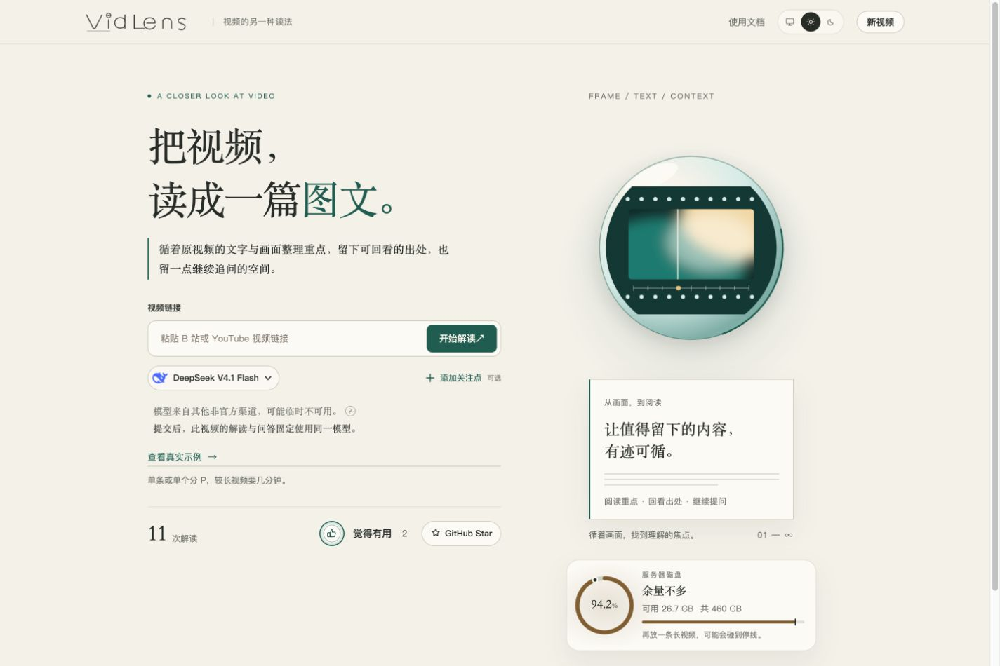
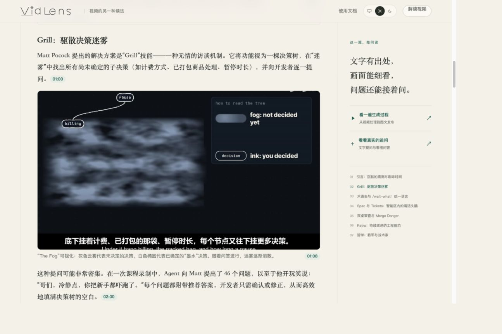
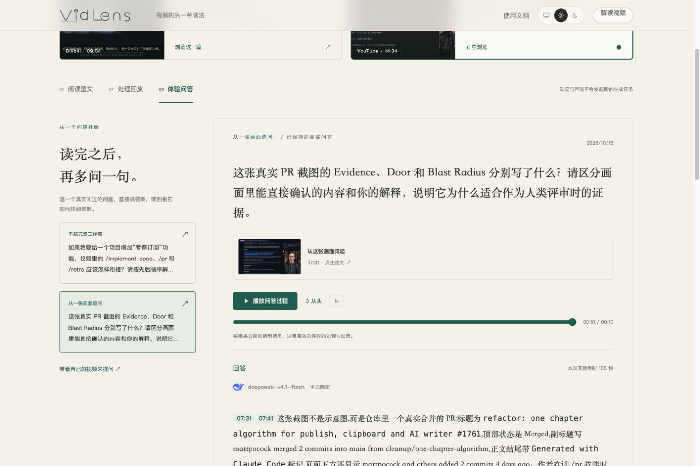
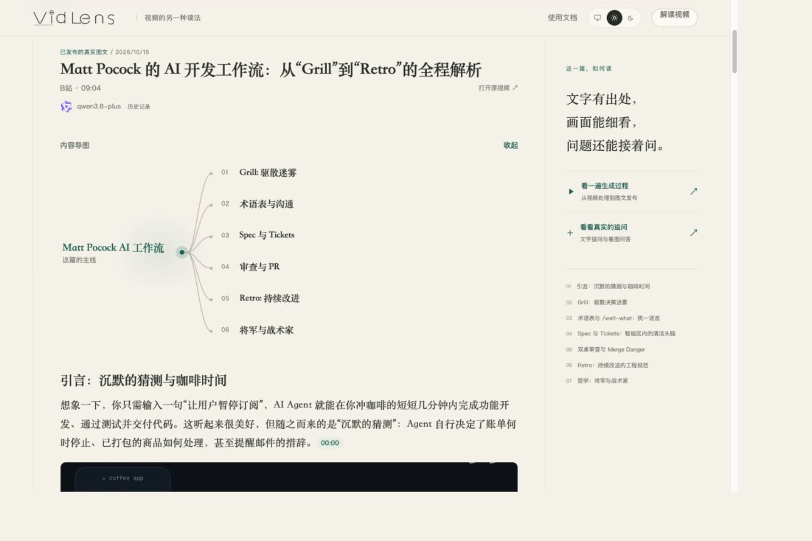
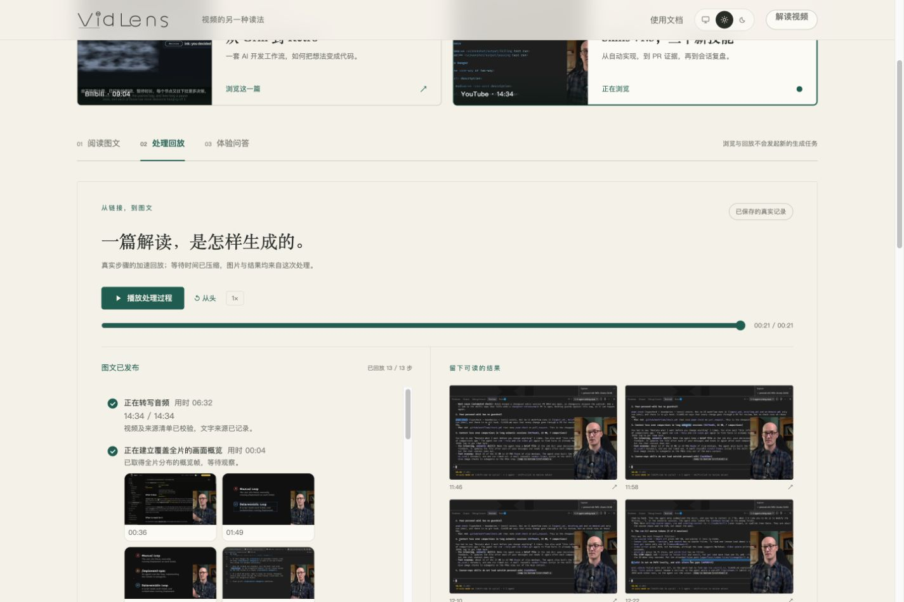

<div align="center">

<picture>
  <source media="(prefers-color-scheme: dark)" srcset="docs/images/readme-banner-dark.svg" />
  <source media="(prefers-color-scheme: light)" srcset="docs/images/readme-banner-light.svg" />
  
</picture>

[简体中文](README.md) · **English**

[Live demo](https://vidlens.wanjune.qzz.io/) · [Real examples](https://vidlens.wanjune.qzz.io/example) · [Quick start](#quick-start) · [Documentation](#documentation)


</div>

VidLens is a video reading tool for the desktop Web. Paste a Bilibili or YouTube video link, choose a model and interpretation depth, and optionally describe your focus. It combines subtitles or speech transcription with actual video frames to produce an illustrated article with timestamped citations and a navigable content map. Then ask follow-up questions about the same video, or select a frame and ask about what you see.

Follow the steps in a tutorial, unpack an idea from a talk, or return to a frame to examine a detail. Keep reading beyond the summary.

## Try a real example

Explore the [saved examples](https://vidlens.wanjune.qzz.io/example) before setting up an environment:

| Example | What you can explore |
| --- | --- |
| [From Grill to Retro · Bilibili / 09:04](https://vidlens.wanjune.qzz.io/example?video=workflow) | Illustrated article, content map, processing replay, text and frame questions |
| [Skills v1.3: Three New Skills · YouTube / 14:34](https://vidlens.wanjune.qzz.io/example?video=skills) | Article, evidence-gathering steps, timestamped answers, and questions about an actual PR shown in the video |

The articles, images, and answers are saved outputs from real runs. Processing and Q&A replays compress waiting time; browsing them makes no new model calls. These examples were specifically prepared for public display. Ordinary visitor articles and questions remain protected by their anonymous session.

## Features

- **Start with a link.** Supports individual Bilibili videos and parts, and individual YouTube videos. Uses available platform subtitles first, with speech transcription as a fallback. No personal platform Cookie is required to acquire videos.
- **Choose depth, focus, and model.** Select concise, standard, or detailed interpretation (standard by default), choose an available model, and optionally describe what matters to you. Every level targets the video's main topics, with a different depth of explanation. The article and its follow-up questions retain the same model version and frozen configuration.
- **Illustrated articles and content maps.** Read structured sections with original video frames, captions, and timestamped citations. Use the content map to follow the main ideas and jump between sections.
- **An Agent that sees the frames.** The model receives usable text and overview frames spanning the video, then retrieves source text, examines time windows and crops, and records observations before producing a result. Visual investigation sends actual image pixels to the model.
- **Ask in words or start from a frame.** Continue asking about the current video, with text and visual evidence in the answer. Inspect images, return to the original timestamps, and see what could not be confirmed.
- **Take the article with you.** Export Markdown or a ZIP containing original article images, source records, and a verification manifest. Exports omit private Q&A and full transcripts.
- **Follow the processing steps.** SSE delivers public activity and final results. Execution state, tool outputs, and checkpoints are persisted so the browser can reload saved status and results.
- **Owner controls and optional web references.** Manage providers, models, and capability checks in a separate owner interface. Eligible suppliers of the same model can serve as fallbacks. Owners can configure public-page reading, Tavily search, and quotas; visitors must opt in per turn, and video and web citations remain distinguishable.

Model and platform availability depend on the provider and deployment environment. Optional web access requires owner configuration and is disabled by default.

## Screenshots

Captured from the desktop Web interface on October 16, 2026. Article and Q&A screens use the saved real examples above. These screenshots predate the interpretation-depth selector. The application UI is currently in Chinese; the header uses the project's existing logo and wordmark.

### One link, with your focus

Choose a model, add an optional focus, and start reading. Light, dark, and system themes are available.



### Read the text. Inspect the evidence.

Article figures come from the original video, with captions and timestamps. Enlarge a frame or follow a citation back to the video.



### Ask one more question about a frame

Select a PR shown in the video and ask about its Evidence, Door, and Blast Radius. The saved answer distinguishes visible details from interpretation.



<details>
<summary>More: content map and processing replay</summary>

**Content map and section navigation:** follow the main ideas, then jump to a section.



**Processing replay:** inspect saved activity and evidence frames. This screen displays a replay of a completed run.



</details>

## From video to reading


1. **Prepare the source.** Resolve the link, acquire media and available subtitles anonymously, transcribe when necessary, and freeze the source snapshot and actual duration.
2. **Investigate the evidence.** A Go / Eino Agent receives complete usable text and overview frames covering the video, then uses source search, time-window reading, frame inspection, and observation tools.
3. **Validate and publish.** The server checks structure, citation ownership, original text spans, frame times, and image files before saving the article. Published articles remain immutable; subsequent answers are stored separately.
4. **Keep reading and asking.** The browser loads saved results and receives public activity through SSE. Q&A concerns the current video and belongs to the current anonymous session.

PostgreSQL owns application state, source snapshots, evidence, and results. Redis / Asynq handles delivery, resource coordination, and small index caches. The application's persistent data directory holds cached media and owned article images. The API and separate worker pools run in one Go process.

Retrieval currently uses time ranges, keywords, and whole-video coverage. Vector retrieval is not enabled. Validation enforces structural and citation constraints; it does not guarantee that a model's interpretation is correct. See [execution and recovery](docs/backend/execution.md).

## Quick start

### Requirements

| Component | Requirement |
| --- | --- |
| Go | 1.26+; not required on the host when running the backend in Docker |
| Node.js | 22+ for frontend development; also usable for native yt-dlp YouTube JavaScript execution |
| Data services | PostgreSQL 17 and Redis 7; Docker Compose is provided |
| Media tools | FFmpeg / ffprobe and `yt-dlp[default]==2026.8.19`; YouTube also needs Deno 2.3+ or Node 22+ |
| Model service | Chat Completions-compatible API with image input and streaming tool calls |
| ASR service | Synchronous OpenAI-compatible multipart audio transcription endpoint |

Use Linux / Docker for the backend on Windows: resource management currently uses Unix system calls. The backend image includes media tools, matching yt-dlp / EJS packages, and Deno.

### 1. Start dependencies and configure

These commands assume a new environment. Preserve an existing configuration; adjust Compose and configuration if the ports are already occupied.

```sh
git clone https://github.com/junnhwan/vid-lens.git
cd vid-lens

docker compose -p vidlens-dev -f compose.backend.yaml up -d postgres redis
mkdir -p .local
cp config.example.yaml .local/backend.yaml
chmod 600 .local/backend.yaml
```

Edit `.local/backend.yaml`: set model and ASR endpoints, model names, and API keys. Generate independent random values of at least 32 characters for `admin_token` and `secret_key`, for example by running `openssl rand -hex 32` separately for each. For native execution, set `data_dir` to an existing, writable absolute directory outside the repository.

YAML product settings and credentials initialize a new database only once. Use the owner interface for later changes. Keep the original `secret_key`: encrypted credentials in PostgreSQL depend on it.

### 2. Start the backend

Run natively after installing the required media tools:

```sh
go run ./cmd/vidlens --config .local/backend.yaml
```

Or run the backend in Docker instead:

```sh
docker compose -p vidlens-dev -f compose.backend.yaml --profile app up -d --build
```

The default Compose database password is for local development. Use independent credentials and isolated volumes for other environments.

### 3. Start the frontend

In another terminal:

```sh
cd frontend
npm ci
npm run dev -- --host 127.0.0.1 --port 5173 --strictPort
```

Open <http://127.0.0.1:5173>. Vite proxies to backend port `127.0.0.1:8086` by default. See [startup and configuration](docs/backend/startup.md), [owner controls and features](docs/backend/product-features.md), and [frontend integration](docs/backend/frontend-integration.md) for port changes, owner password setup, the model catalog, and production proxy configuration.

## Scope and limitations

- Interpretation and Q&A target one current video. Local file uploads, multi-video knowledge bases, and arbitrary-length video processing are not offered. Input, call, time, and disk budgets can stop processing explicitly.
- Anonymous acquisition may still be refused or require platform verification. Private, paid, members-only, and age-restricted sources are not guaranteed. Bilibili quality depends on the public tracks actually returned and resource limits.
- Visitors use anonymous sessions. Ordinary articles and Q&A have no public sharing feature. Sessions last 30 days from creation by default; lost Cookies or expired sessions have no account-based recovery. Export content you want to keep.
- ASR is a fallback when subtitles are unavailable. For text-only ASR responses, citations use actual audio windows without inventing sentence timestamps. Follow-up answers do not rewrite the published article.
- SSE exposes public steps and final results, without streaming answer tokens to visitors. Automated checks do not establish compatibility or quality for every provider, video, or environment.

## Development and verification

```sh
go test ./cmd/... ./internal/...
go vet ./cmd/... ./internal/...
go build -o .local/bin/vidlens ./cmd/vidlens

cd frontend
npm test
npm run build
```

The frontend build includes TypeScript checking. Backend integration tests additionally need `VIDLENS_TEST_DATABASE_URL` and `VIDLENS_TEST_REDIS_URL`, pointing at an isolated test database and Redis logical DB. PostgreSQL tests create and remove random schemas. Media tests need FFmpeg / ffprobe. Real model and ASR verification makes provider calls.

Production requires same-origin static hosting and API proxying, unbuffered SSE, private configuration, and persistent data. See the [nginx example](config-examples/nginx.conf.example). This repository has no GitHub Actions deployment workflow; pushing source does not deploy it.

## Documentation

| Guide | Contents |
| --- | --- |
| [Startup and owner configuration](docs/backend/startup.md) | Environment, initialization, platform acquisition, passwords, and access |
| [Model management and exports](docs/backend/product-features.md) | Model revisions, supplier failover, Markdown / ZIP, and optional web references |
| [Execution and recovery](docs/backend/execution.md) | Evidence tools, publication checks, checkpoints, resources, and file lifetimes |
| [Frontend integration](docs/backend/frontend-integration.md) | API, SSE, anonymous sessions, and interaction contracts |
| [User documentation](docs/site/index.md) | Reading, questions, citations, exports, and privacy; currently in Chinese |
| [README visual assets](docs/readme-assets.md) | Screenshot provenance, example attribution, and visual maintenance |

Source layout: `cmd/vidlens/` is the backend entrypoint, `internal/` contains Go application modules, and `frontend/` is the React / TypeScript / Vite application. `docs/prototype/` is a static design reference.

## Feedback and discussion

Report problems and suggestions through [GitHub Issues](https://github.com/junnhwan/vid-lens/issues), or discuss your experience on [linux.do](https://linux.do/). Include reproduction steps and shareable error details; omit API keys, Cookies, and private Q&A.

## Star History

<a href="https://www.star-history.com/?repos=junnhwan%2Fvid-lens&type=date&legend=top-left">
  <picture>
    <source media="(prefers-color-scheme: dark)" srcset="https://api.star-history.com/chart?repos=junnhwan/vid-lens&type=date&theme=dark&legend=top-left" />
    <source media="(prefers-color-scheme: light)" srcset="https://api.star-history.com/chart?repos=junnhwan/vid-lens&type=date&legend=top-left" />
    
  </picture>
</a>
