

# VidLens · 映知

**让视频变得可读：阅读 · 回看 · 追问**

<picture>
  <source media="(prefers-color-scheme: dark)" srcset="./docs/images/readme-banner-dark.svg" />
  <source media="(prefers-color-scheme: light)" srcset="./docs/images/readme-banner-light.svg" />
  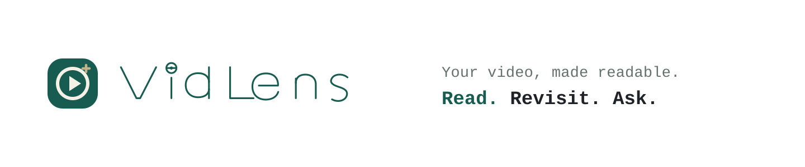
</picture>

**简体中文** · [English](README.en.md)

    

[在线体验](https://vidlens.wanjune.qzz.io/) · [真实示例](https://vidlens.wanjune.qzz.io/example) · [Linux.do 交流](https://linux.do/) · [本地开发](docs/backend/startup.md)

VidLens 面向桌面浏览器，把 B 站或 YouTube 视频整理成带章节、真实画面、时间出处和内容导图的图文文章。你可以选择解读深度与关注点，阅读时回看来源，也可以继续提问。

## 先看真实示例

[打开真实示例](https://vidlens.wanjune.qzz.io/example)。页面展示已经发布、并被选中公开的图文。浏览示例不会发起新的模型调用。

## 实际阅读与追问界面

以下截图来自对 3Blue1Brown 的 [But what is a neural network? | Deep learning chapter 1](https://www.youtube.com/watch?v=aircAruvnKk)（18:39）的实际解读，展示从提交链接到图文阅读、画面追问的桌面 Web 流程。

### 提交视频，选择解读方式

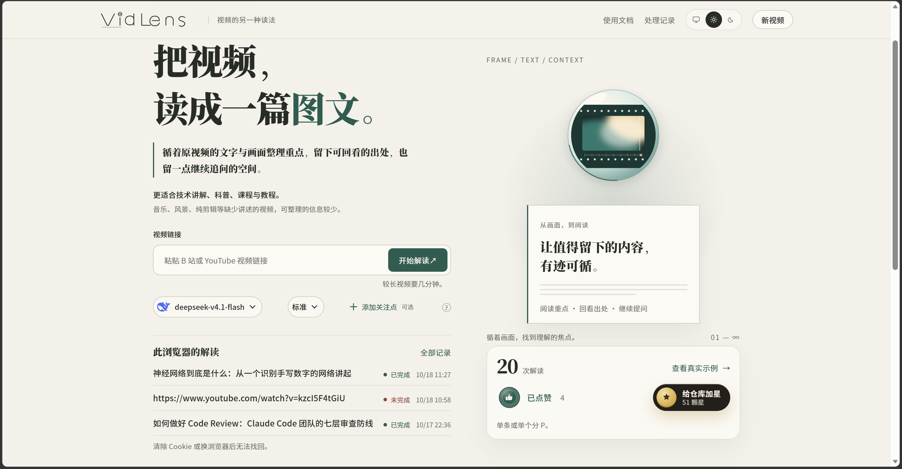

### 用导图把握全片结构

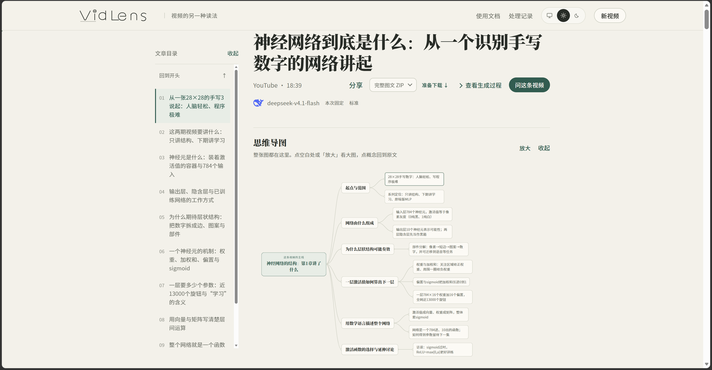

### 阅读正文，回看真实画面

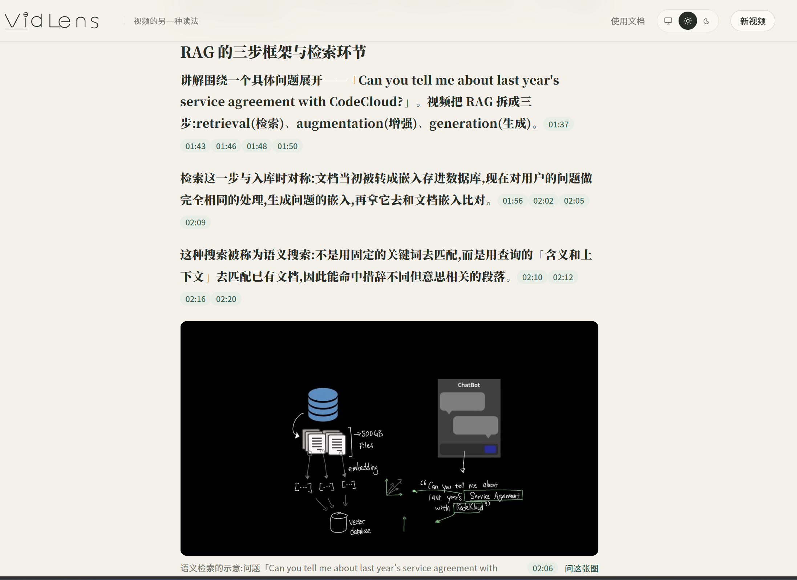

### 边读边问，查看带出处的回答

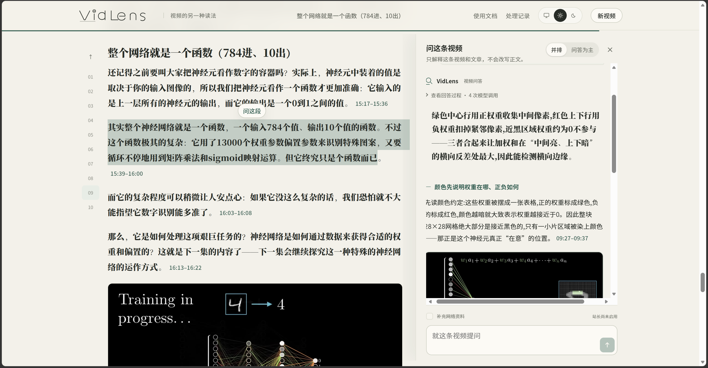

展开：选段追问、画面取证与专注问答（2 张）

#### 选中段落，查看取证过程

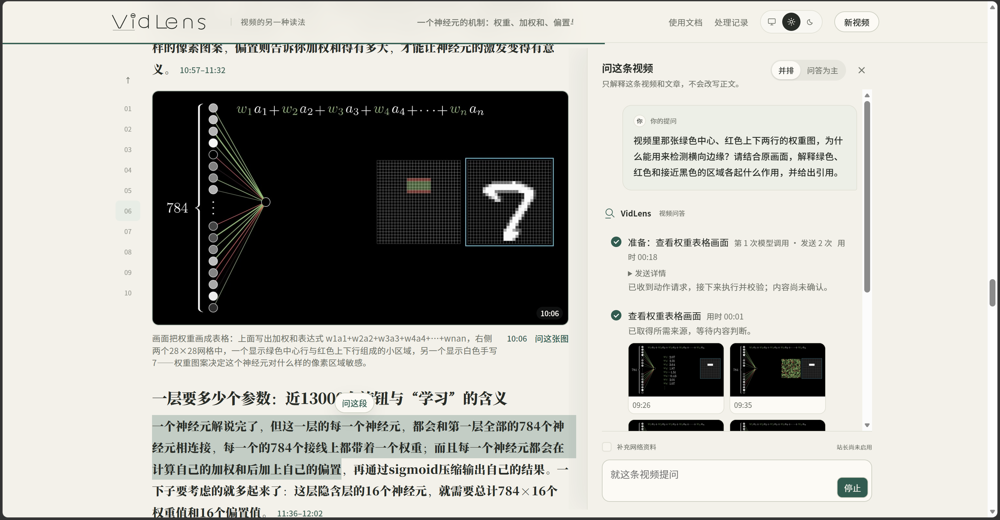

#### 切换到「问答为主」

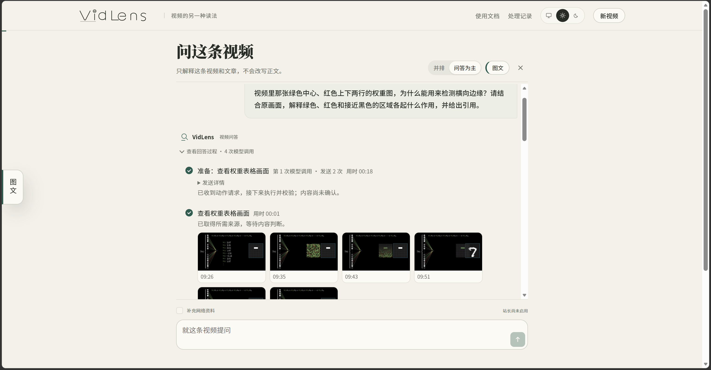

展开：从来源准备到文章发布的处理过程（5 张）

进度、调用次数与用时均为截图捕获时的状态，不构成处理时长承诺。

#### 查看当前阶段与执行计划

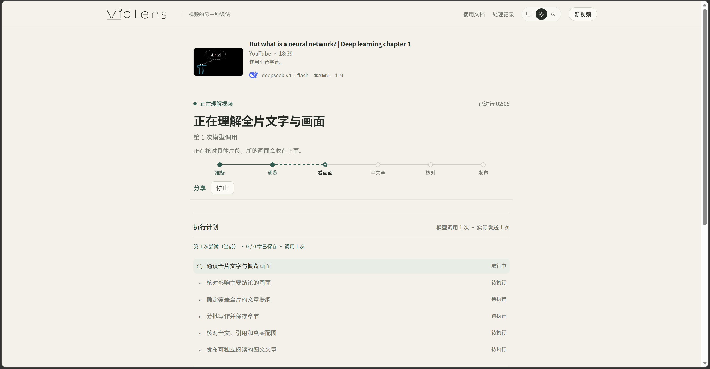

#### 准备字幕与全片概览画面

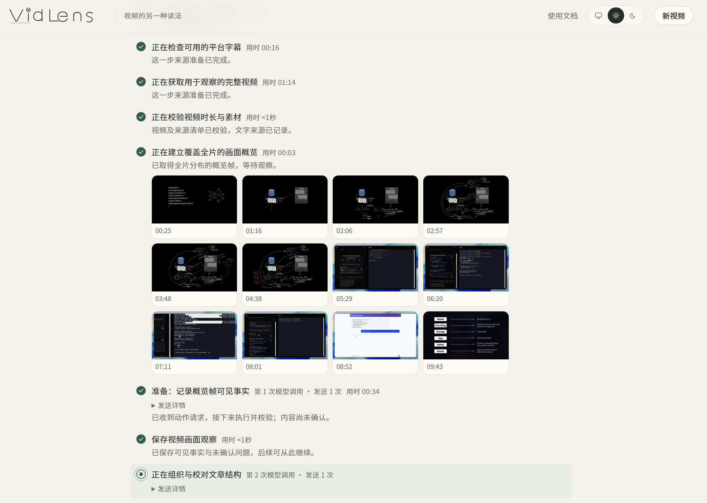

#### 组织与核对文章结构

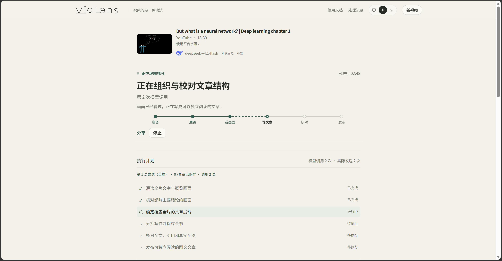

#### 核对画面，保存观察与正文

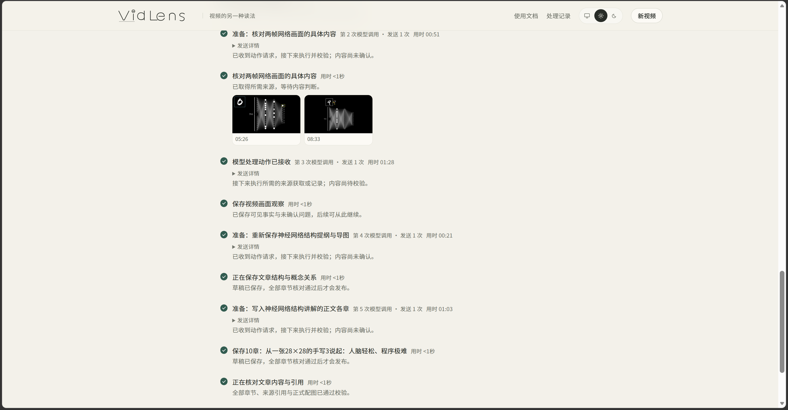

#### 完成后开始阅读

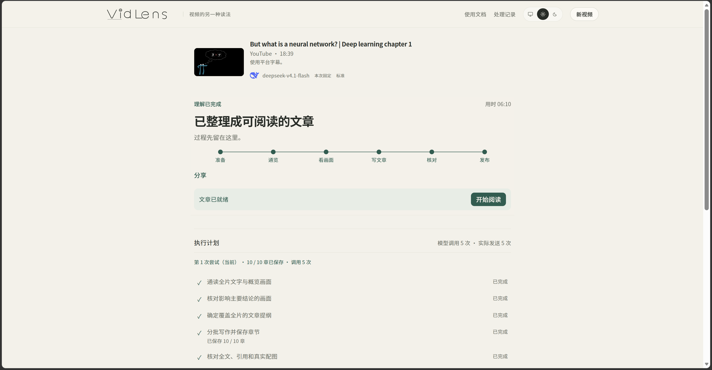

## 核心能力

- **从视频开始**：支持 B 站单条视频、单个分 P 和 YouTube 单条视频；优先使用字幕，缺失时进行语音转写，不需要个人平台 Cookie。
- **带出处阅读**：文章按章节组织，包含真实画面、时间引用和内容导图；可导出 Markdown 或图文 ZIP。
- **先交付文章**：生成后即可阅读和导出，自动审核最多一次并单独提供建议；需要时可主动再次审核。
- **按需选择画面**：围绕章节内容取图，必要时微调截图时间或查看细节；配图数量随内容变化，找不到合适画面时继续交付正文。
- **围绕证据提问**：可追问文章、段落或选中画面，必要时在低信息画面附近补看；先展示有来源的参考解读，随后明确标注独立核验状态，并单列未确认项。
- **从具体问题开始**：新图文交付后预备针对该视频的提问，空会话可直接选择、编辑；打开或切换会话不重复生成，旧文章可从章节开始追问。
- **查看实际进度**：页面展示来源准备、取证、写作和校验过程，已保存的步骤可以回看。服务启用时，也可对单轮问答选择补充公开网页资料。
- **分享单条记录**：创建可取消的只读链接，让其他人查看这一次的图文与处理过程；私人追问保持私有。

## 架构概览

这张图概括了从视频链接到图文阅读的流程，以及当前应用服务、Agent、队列和持久化存储之间的关系。

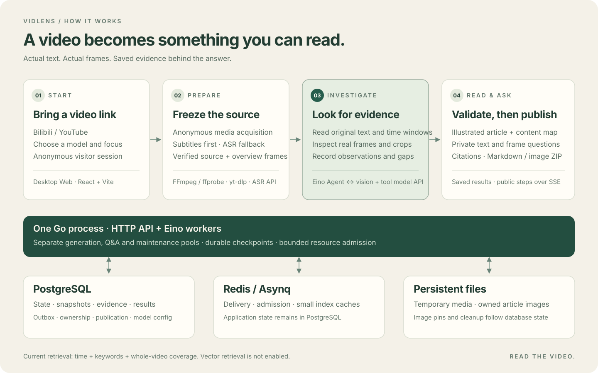

## 适合什么视频

技术讲解、科普、课程和操作教程等讲述清晰的视频更适合整理成图文。音乐、风景或纯剪辑视频可供整理的信息较少；静态画面也无法完整表达连续动作、节奏或剧情。无关内容，或恶意提交的超大视频，会被直接清理。结果会受字幕、转写、画面清晰度和模型服务影响。详见[选片建议](docs/site/start.md)。

## 本地开发

需要 Go 1.26+、Node.js 22+、PostgreSQL 17、Redis 7 和 FFmpeg；Windows 上运行后端需使用 Linux/Docker 环境。完整步骤见[启动与配置](docs/backend/startup.md)。

## 文档

[使用指南](docs/site/index.md) · [隐私与保留](docs/site/privacy.md) · [Agent 执行与恢复](docs/backend/execution.md)

## 社区与反馈

VidLens 的发布与讨论在 [Linux.do](https://linux.do/)；欢迎分享体验、提问和交流建议。技术问题与可复现的缺陷也可以提交到 [GitHub Issues](https://github.com/junnhwan/vid-lens/issues)。

网站面向桌面浏览器，访客无需注册；文章和问答由当前匿名会话持有。主动分享单条记录后，获得链接的人可只读查看该条图文与处理过程，私人追问不随链接公开。详情见[隐私与保留](docs/site/privacy.md)。

## Star History

