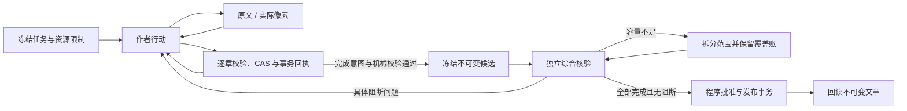

# 完整文章 Harness

文章循环契约在任务创建时冻结，与问答契约独立。当前可显式选择 `vidlens-article-loop-2026-10-22-v2`，历史 v1 保留原报告和策略身份。它保留来源快照、真实帧、操作账、claim/fence、草稿 CAS 和发布事务，替换文章的固定阶段主链。既有默认和历史任务继续执行冻结的 Adapter。本地契约验证通过不代表文章质量或真实交付率改善。

## 活动调用图

作者可以读取原文、查看画面、读取当前稿件、保存章节并请求完成。第一份正文可同时建立结构，保存时也可携带完成意图。程序构造 `domain.Article`：作者不生成渲染 AST、块 ID、来源元数据或精确起止时间。`text / quote / list / code / table / figure / background` 是互斥语义构造，列表项与表格行分别带来源；逐字引述须匹配连续原文。视觉断言需要实际交付像素和简短观察。

作者读取的当前稿件使用同一个语义写入结构，保留稳定章节身份、来源别名、观察及局限。v2 独立核验者读取从固定 canonical Article 逐块展开的完整语义正文，保留全部文字、列表、代码、表格、图注、限制和引用位置；精简绑定将引用连到实际原文别名或像素，服务端仍持有完整身份。它按读者顺序检查每章开头、结尾和章间关系。局限代码的实际工具 schema 与校验器共享领域枚举。

完整 JSON 信封中的章节独立校验。合法子集和 accepted/rejected 回执在同一事务提交；截断、重复键、跨章身份歧义不猜测修复。重放返回原回执，内容不变不增加版本。删除与重排是独立原子行动。

## 完成与恢复

完整交付同时要求全片主要主题、来源忠实、就近且语义支持的引用、相关真实配图、独立可读、具体局限、合法资源与固定候选的完整核验。原文范围已交付仅证明访问，不证明理解。闲置帧不需要观察回执；使用的视觉证据必须交付并被核验。普通文本结束、草稿或空问题列表均不是成功。

核验上下文不包含作者推理，程序绑定候选、来源/图片指纹、策略和范围。容量内一次综合核验；容量不足才拆分，并检查全篇主题与跨章关系。核验故障只恢复未完成核验。任何正文、标题、图注、图片、局限或结构变化都会使旧全文批准失效。所有发布入口只读取批准，不临时调用模型；发布事务再次比较当前稿件、候选、来源、资产和批准，终态以事务提交及回读为准。

v2 的综合核验先记录所用实际画面的独立可见事实及不确定性，再与程序提取的图注、视觉正文位置对照。观察与作者记录分离，不要求审核闲置概览。程序验证每个当前范围的像素都有独立观察、身份真实且不重复，发布事务再次检查。AC02–05/07 的已识别缺陷不能被标为 advisory；矛盾报告退给同一核验者澄清，程序不擅自升级或据此重写正文。画面支持性、配图解释价值与文字可读性仍由语义核验负责，结构通过不能代替真实模型校准。

v2 文章和对应问答在模型发送边界保留完整文字与工具交换，将本次实际图片字节集中到最后一条用户消息，兼容只转发末条消息图片的接入端。持久化输入仍保留原帧身份，传输记录只增加图片 SHA256、字节数与消息位置，不存图片数据。历史契约保持原发送顺序。

逻辑调用和物理发送共用冻结总上限 `min(20, profile.MaxIterations)`，包括作者、核验、修复及未知发送。资源限制、活跃时间和端到端期限沿用冻结配置。按当前候选规模预留核验预算。输出截断缩小下一次输出或核验范围，不缩小原文输入；上下文超限才缩小原文交付，未读义务保留。v2 已开始的响应达到单次期限时，未知发送仍计账，下一调用缩小工作范围，不盲目重发相同大请求；无响应、网络故障和父任务到期仍分开处理。只复用完整持久化响应，费用无证据时为 unknown。重复相同失败、同稿提交或等价取景不算进展。

## 兼容与退出

新路径不调用 `runWorkflowArticle`、`workflowStage`、固定五批写作/审核、`workflowCallLimits`、全篇 `format:1`、旧逐项审核门禁或隐式 `autoFinalize`。这些实现作为历史任务 Adapter 保留，不是新循环的 fallback。

同一 run 恢复保留原契约、输入、账和预算。旧 staged 草稿显式重试继续使用兼容 staged Adapter；新循环显式重试只导入来源归属已验证的稿件/资产，记录父 run 与版本，重新读取来源和核验，不导入批准、调用槽或阶段状态。读端和 Markdown/ZIP 继续使用现有文章结构。

问答保留独立 V9/V12 执行与验证 Adapter。v2 文章的新问答另冻结 `qa-article-reading-2026-10-22-v2` 输入修订：全文阅读上下文与提交工具共享语义结构，程序构造渲染节点，短编号由服务端恢复真实引用；普通、图片和外部资料仍须通过既有来源及独立核验。当前问题实际读到的原文切片按身份去重保留，不因超过两次读取而丢失；真实容量检查仍生效。就绪状态按本问取证与冻结剩余时间计算，不继承整片成文义务。历史文章和已创建问答保留其冻结输入与工具格式。

实现入口为 `internal/investigator/article_loop*.go`，事务发布约束在 `internal/store/article_loop.go`。脚本化供应商经同一模型调用 Interface 验证正常与故障路径；真实模型的主题识别、错引识别、配图相关性及交付率仍需独立标注和配对比较。
